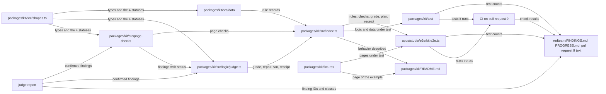

# CONNECTIONS — kit repairs (pull request 9)

An edge `A -->|label| B` means B depends on A.

## Graph

## Edge list

| From | To | Label | Broken when |
|---|---|---|---|
| shapes.ts | data | types and the 4 statuses | `npm run check` reports a type error |
| shapes.ts | logic/judge.ts | types and the 4 statuses | a status in shapes.ts is one `grade` does not count |
| shapes.ts | page-checks | types and the 4 statuses | a check returns a status absent from shapes.ts |
| data | index.ts | rule records | a floor in the data is absent from `KIT_RULES` |
| page-checks | index.ts | page checks | an exported check is absent or renamed |
| logic/judge.ts | index.ts | grade, repairPlan, receipt | an export is absent or renamed |
| page-checks | logic/judge.ts | findings with status | a failed floor ends in a grade above "Below floor" |
| index.ts | kit.e2e.ts | rules, checks, grade, plan, receipt | the kit browser test fails |
| fixtures | kit.e2e.ts | pages under test | a planted defect is not found, or the page built with care fails a check |
| index.ts | packages/kit/test | logic and data under test | `npm test` fails |
| index.ts | README.md | behavior described | a README statement does not reproduce |
| fixtures | README.md | page of the example | the README example ends in another grade than the README states |
| judge report | page-checks | confirmed findings | a confirmed blocker or major still reproduces |
| judge report | logic/judge.ts | confirmed findings | a confirmed blocker or major still reproduces |
| judge report | records | finding IDs and classes | a confirmed finding has no row |
| kit.e2e.ts | records | test counts | a count in a record differs from the command output |
| packages/kit/test | records | test counts | a count in a record differs from the command output |
| CI | records | check results | a record states green while a check is red |
| kit.e2e.ts | CI | tests it runs | CI is red on a browser test |
| packages/kit/test | CI | tests it runs | CI is red on a unit test |

## Nodes outside the DELIVERABLE

| Node | Kind | Version or date checked |
|---|---|---|
| Playwright | library | 1.65.0 (package.json), 2026-11-24 |
| Chromium for the browser tests | library | revision 1255 through `PW_CHROMIUM`, 2026-11-24 |
| Second review: 3 reviewer reports (`evidence/second-review/`, with hashes) and the judge report | document | reviewers done 2026-11-24; judge running at 2026-11-24T20:27Z |
| CI on pull request 9 (GitHub Actions) | service | 2026-11-24 |
