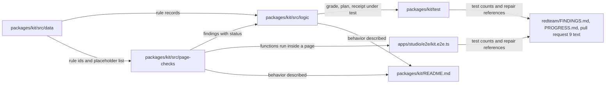

# CONNECTIONS — kit repairs (pull request 9)

An edge `A -->|label| B` means B depends on A.

## Graph

## Edge list

| From | To | Label | Broken when |
|---|---|---|---|
| packages/kit/src/data | packages/kit/src/logic | rule records | `npm run check` fails, or a floor in the data is absent from the grade |
| packages/kit/src/data | packages/kit/src/page-checks | rule ids and placeholder list | the unit test "the placeholder list of the page check equals the list of the Brief" fails |
| packages/kit/src/page-checks | packages/kit/src/logic | findings with status | a status the checks emit is one the grade does not count |
| packages/kit/src/page-checks | apps/studio/e2e/kit.e2e.ts | functions run inside a page | the kit browser test fails |
| packages/kit/src/logic | packages/kit/test | grade, plan, receipt under test | `npm test` fails |
| packages/kit/src/page-checks | packages/kit/README.md | behavior described | a README statement does not reproduce |
| packages/kit/src/logic | packages/kit/README.md | behavior described | a README statement does not reproduce |
| apps/studio/e2e/kit.e2e.ts | redteam/FINDINGS.md, PROGRESS.md, pull request 9 text | test counts and repair references | a count in a record differs from the command output |
| packages/kit/test | redteam/FINDINGS.md, PROGRESS.md, pull request 9 text | test counts and repair references | a count in a record differs from the command output |

## Nodes outside the DELIVERABLE

| Node | Kind | Version or date checked |
|---|---|---|
| Playwright | library | 1.65.0 (package.json), 2026-11-24 |
| Chromium for the browser tests | library | revision 1255 through `PW_CHROMIUM`, 2026-11-24 |
| Second review: 3 reviewer reports and the judge report | document | reviewers done 2026-11-24; judge running |
