# MINDMAP — kit repairs (pull request 9)

## Hierarchy

- **Goal:** "First, please use Hinshitsu." on the kit repairs of pull request 9
  - **C1** confirmed blockers and majors no longer appear
    - **WU-1** the module `packages/kit` with its browser test
  - **C2** confirmed minors and owner items each have a row
    - **WU-2** the records
  - **C3** 1 commit per repair with its test; no test weakened
    - **WU-1** the module `packages/kit` with its browser test
  - **C4** npm run check exits 0
    - **WU-1** the module `packages/kit` with its browser test
  - **C5** npm run e2e exits 0, 3 times
    - **WU-1** the module `packages/kit` with its browser test
  - **C6** CI green on pull request 9
    - **WU-1** the module `packages/kit` with its browser test
  - **C7** records equal command output
    - **WU-2** the records
  - **C8** no Neon, no Vercel
    - **WU-1** the module `packages/kit` with its browser test
  - **C9** nothing pushed to CatCorner22/Frontend
    - **WU-2** the records
  - **C10** pull request 9 not merged
    - **WU-2** the records
  - **C11** no claim that output meets a standard
    - **WU-2** the records
  - **C12** full record of the run
    - **WU-2** the records
  - **C13** delivered commit equals audited commit outside the RUN FOLDER
    - **WU-2** the records
  - **C14** lines after the judge pin reviewed from zero
    - **WU-1** the module `packages/kit` with its browser test
  - **C15** each RECIPIENT can use it
    - **WU-2** the records
  - **C16** short delivery message in plain words
    - **WU-2** the records
  - Decisions: **D-001** the run starts on work that exists; **D-002** no change before the S6 answer; **D-003** the judge report names the repairs; **D-004** local Chromium 1255 counts; CI is the control; **D-005** 2 WORK UNITS; M5 not started

## Diagram

```mermaid
graph TD
  G["Goal: use Hinshitsu on the kit repairs of pull request 9"]
  WU1["WU-1 packages/kit and its browser test"]
  WU2["WU-2 the records"]
  G --> C1["C1 confirmed blockers and majors no longer appear"]
  C1 --> WU1
  G --> C2["C2 confirmed minors and owner items each have a row"]
  C2 --> WU2
  G --> C3["C3 1 commit per repair with its test; no test weakened"]
  C3 --> WU1
  G --> C4["C4 npm run check exits 0"]
  C4 --> WU1
  G --> C5["C5 npm run e2e exits 0, 3 times"]
  C5 --> WU1
  G --> C6["C6 CI green on pull request 9"]
  C6 --> WU1
  G --> C7["C7 records equal command output"]
  C7 --> WU2
  G --> C8["C8 no Neon, no Vercel"]
  C8 --> WU1
  G --> C9["C9 nothing pushed to CatCorner22/Frontend"]
  C9 --> WU2
  G --> C10["C10 pull request 9 not merged"]
  C10 --> WU2
  G --> C11["C11 no claim that output meets a standard"]
  C11 --> WU2
  G --> C12["C12 full record of the run"]
  C12 --> WU2
  G --> C13["C13 delivered commit equals audited commit outside the RUN FOLDER"]
  C13 --> WU2
  G --> C14["C14 lines after the judge pin reviewed from zero"]
  C14 --> WU1
  G --> C15["C15 each RECIPIENT can use it"]
  C15 --> WU2
  G --> C16["C16 short delivery message in plain words"]
  C16 --> WU2
  WU1 --> D001["D-001 the run starts on work that exists"]
  WU1 --> D002["D-002 no change before the S6 answer"]
  WU1 --> D003["D-003 the judge report names the repairs"]
  WU1 --> D004["D-004 local Chromium 1255 counts; CI is the control"]
  WU1 --> D005["D-005 2 WORK UNITS; M5 not started"]
  C11 --> F1["F-1 BLOCKER: C11 test prints RUN FOLDER lines (open)"]
  C12 --> F2["F-2 BLOCKER: C12 test red on E-1, E-2 (open)"]
  C3 --> F3["F-3 BLOCKER: baseline 86287c2 hides earlier edits (open)"]
  C1 --> F4["F-4 BLOCKER: lines after the judge pin unseen (open)"]
  C5 --> F5["F-5 BLOCKER: C5 not repeatable without PW_CHROMIUM (open)"]
  C8 --> F6["F-6 BLOCKER: C8 and C7 cannot both pass (open)"]
  C1 --> F7["F-7 BLOCKER: 0 repairs can end VERIFIED (open)"]
```

## Node check

| Kind | Count in `AUDIT-LOG.md` | Count in this map |
|---|---|---|
| CRITERIA | 16 | 16 |
| WORK UNITS | 2 | 2 |
| Decisions | 5 | 5 |
| FINDINGS | 7 | 7 |

<!-- from the log: start -->
Rebuilt by `scripts/hinshitsu_log.py state`. Do not edit between the marks.
- F-1 , test of C11 (BLOCKER, FIXED by E-45)
- F-2 , test of C12; , (BLOCKER, FIXED by E-46)
- F-3 , baseline 86287c2 of C3, C8, C11 (BLOCKER, FIXED by E-47)
- F-4 D-003, C1 (BLOCKER, FIXED by E-48)
- F-5 , C5; A-2 (BLOCKER, FIXED by E-49)
- F-6 , C8 (BLOCKER, FIXED by E-50)
- F-7 , C1 to C3 (BLOCKER, FIXED by E-52)
- F-8 see finding 1 of `audits/WU1-correctness-.md` (BLOCKER, open)
- F-9 see finding 2 of `audits/WU1-correctness-.md` (BLOCKER, open)
- F-10 see finding 3 of `audits/WU1-correctness-.md` (FRAGILITY, open)
- F-11 see finding 4 of `audits/WU1-correctness-.md` (DEFECT, open)
- F-12 see finding 5 of `audits/WU1-correctness-.md` (DEFECT, open)
- F-13 see finding 6 of `audits/WU1-correctness-.md` (DEFECT, open)
- F-14 see finding 7 of `audits/WU1-correctness-.md` (DEFECT, open)
- F-15 see finding 8 of `audits/WU1-correctness-.md` (DEFECT, open)
- F-16 see finding 9 of `audits/WU1-correctness-.md` (DEFECT, open)
- F-17 see finding 10 of `audits/WU1-correctness-.md` (DEFECT, open)
- F-18 see finding 11 of `audits/WU1-correctness-.md` (FRAGILITY, open)
- F-19 `packages/kit/src/logic/judge.ts:87` in `audit/wu1-k3`. (BLOCKER, open)
- F-20 `packages/kit/src/page-checks/neuro.ts:286–298` (`noSidewaysScroll`). (BLOCKER, open)
- F-21 `packages/kit/src/page-checks/neuro.ts:23–60` (`noEndlessMotion`). (BLOCKER, open)
- F-22 `packages/kit/src/page-checks/behavior.ts:211–260` (`controlsHaveNames`). (BLOCKER, open)
- F-23 `packages/kit/src/page-checks/behavior.ts:85–130` (`focusIsVisible`); `packages/kit/src/logic/designId.ts` (`tidy`). (BLOCKER, open)
- F-24 `packages/kit/src/data/placeholders.ts:6–27` (`address line 1`, `service 1`); `packages/kit/src/page-checks/tells.ts:6–60`. (BLOCKER, open)
- F-25 `packages/kit/src/page-checks/neuro.ts:282–296`. (DEFECT, open)
- F-26 `packages/kit/src/page-checks/neuro.ts:308–432` (`noScriptedMotion`; the observer filters attributes to `style`, `class`, `src`, `hidden` and watches `body` only). (DEFECT, open)
- F-27 `packages/kit/test/kit.test.ts`, design ID tests (the test `reads a value of many unclosed url( in little time…`, line 314). (DEFECT, open)
- F-28 `packages/kit/test/kit.test.ts`, test `a status outside the four counts as "could not measure"…`: its `repairPlan` case puts the unknown status in the newest round only. (DEFECT, open)
- F-29 `vitest.config.ts:2`. (BLOCKER, open)
- F-30 `packages/kit/src/page-checks/neuro.ts:174–215` (`visibleLabels`), `behavior.ts:6–84` (`keyboardReachable`). (FRAGILITY, open)
- F-31 `packages/kit/src/page-checks/neuro.ts:23–60`. (DEFECT, open)
- F-32 `packages/kit/src/logic/judge.ts`, `sound()`. (FRAGILITY, open)
- F-33 `redteam/FINDINGS.md:107` (commits `1115cfd` and `7a345e2`). (STYLE, open)
- F-34 `PROGRESS.md` line 36 ("a receipt in three lists that never mix"); the same count in `packages/kit/test/kit.test.ts` line 220 (test title "keeps the three lists apart") and `packages/kit/README.md` line 54 (comment "measured / not measured / a person must still check"). (BLOCKER, open)
- F-35 `PROGRESS.md` line 44 ("the judge confirmed 9 major and 23 minor findings"); `redteam/FINDINGS.md` line 107 (row R2-, class "minor"). (BLOCKER, open)
- F-36 `packages/kit/src/logic/judge.ts` line 25 (comment of `grade`: "The grade covers only what programs measured.") and line 170 (`Grade of the measured part:`). (DEFECT, open)
- F-37 `packages/kit/src/page-checks/neuro.ts` line 408, against lines 51-52 and 398-399. (DEFECT, open)
- F-38 `packages/kit/src/page-checks/neuro.ts` lines 31-32 (comments left above the new `hasPause`). (DEFECT, open)
- F-39 `packages/kit/src/data/brief.ts` lines 50-51. (DEFECT, open)
- F-40 `apps/studio/e2e/kit.e2e.ts` lines 891-893. (DEFECT, open)
- F-41 `DECISIONS.md` line 75 (row D63); `docs/owner-instructions.md`. (DEFECT, open)
- F-42 `packages/kit/src/data/craft.ts` line 6, `fit.ts` line 4, `neuro.ts` line 11, `states.ts` line 8 (`const reviewed = '2026-11-18'`). (DEFECT, open)
- F-43 `packages/kit/src/page-checks/behavior.ts` line 63 and `neuro.ts` line 188 (2 copies of `unmet`); the 4 tests of "is this `::before` drawn" in `behavior.ts` line 114, `fit.ts` line 126, `neuro.ts` line 62, `tells.ts` line 112. (FRAGILITY, open)
- F-44 `packages/kit/src/page-checks/behavior.ts` line 287 (`.slice(0, 200)`, `.slice(0, 50)`); `neuro.ts` lines 36 and 315 (`.slice(0, 2000)`). (FRAGILITY, open)
- F-45 `packages/kit/test/kit.test.ts` lines 318, 344, 437, 443; `apps/studio/e2e/kit.e2e.ts` lines 263 and 930. (FRAGILITY, open)
- F-46 `scripts/audit.mjs` lines 66 and 71. (FRAGILITY, open)
- F-47 `packages/kit/src/logic/judge.ts` line 109 (`?? 'Make this rule hold.'`); `page-checks/behavior.ts` line 166 (`?? measure(el)`). (STYLE, open)
- F-48 `packages/kit/src/logic/judge.ts` lines 13-18 and line 46. (STYLE, open)
- F-49 `packages/kit/src/page-checks/fit.ts` lines 80, 113, 122, 130; `behavior.ts` line 106; `tells.ts` line 120. Also `brief.ts` line 12 and `placeholders.ts` line 28; `tells.ts` lines 51 and 54; `behavior.ts` lines 100-104. (STYLE, open)
- F-50 `packages/kit/src/page-checks/behavior.ts` line 316 (`nextTells`); `tells.ts` line 5; `neuro.ts` lines 184-190. (STYLE, open)
- F-51 `packages/kit/src/page-checks/behavior.ts` line 90; `apps/studio/e2e/kit.e2e.ts` lines 637-652 and line 869; `craft.ts` lines 126 and 201. (STYLE, open)
- F-52 `apps/studio/e2e/kit.e2e.ts` lines 374, 386, 662 (`gif`, 2 different pictures under 1 name); 528 and 534 (`turn`); 746 and 763 (`track`); the list of the 3 person-only floors written twice in 1 test (lines 94-95); `packages/kit/test/kit.test.ts` line 508. (STYLE, open)
- F-53 `package.json` line 25 (`"audit:deps"`). (STYLE, open)
- F-54 `vitest.config.ts` line 2 (commit `f2ef274`). (BLOCKER, open)
- F-55 `packages/kit/src/logic/judge.ts` line 50; also the comment at line 25 and the heading at line 170. (DEFECT, open)
- F-56 `packages/kit/src/shapes.ts` line 2 (added); `packages/kit/README.md` lines 45–50 (changed in this unit); `apps/studio/e2e/kit.e2e.ts` `runAll` and `runAllWithReflow` (lines 29–44). (DEFECT, open)
- F-57 `packages/kit/src/logic/designId.ts` line 16; comment at line 8; test comment "A value that is not text is read as its text, and does not throw" in `packages/kit/test/kit.test.ts`. (DEFECT, open)
- F-58 `packages/kit/src/page-checks/behavior.ts` line 67: `(view ?? window).getComputedStyle(at)`; line 68 `view?.scrollY ?? 0`. (FRAGILITY, open)
- F-59 `behavior.ts` line 114 (content matches `none|normal|""|''`, or `display: none`, or not visible, or opacity 0); `fit.ts` lines 124–126 (`none` or `normal`, `display`, `visibility !== 'visible'`); `neuro.ts` lines 60–62 (`none`, `normal`, `display`, `visibility !== 'hidden'`); `tells.ts` line 112 (`… (FRAGILITY, open)
- F-60 `/#[0-9a-f]{3,8}\b|\b(?:rgba?|hsla?|hwb|lab|lch|oklab|oklch|color)\([^()]*\)/gi` at `fit.ts` lines 80, 113, 122, 130 (4 times inside the one function `tokenFit`), `behavior.ts` line 106, `tells.ts` line 120. (STYLE, open)
- F-61 `packages/kit/test/kit.test.ts` lines 318 (`< 2000` ms, `Date.now()`), 344 (`< 5000`), 437 and 443 (`< 3000`, `performance.now()`); `apps/studio/e2e/kit.e2e.ts` lines 263 (`< 40000`) and 930 (`< 10_000`). (FRAGILITY, open)
- F-62 `apps/studio/e2e/kit.e2e.ts` lines 264, 525, 531, 553 (`60000`) and 743, 760, 777 (`60_000`); default `testTimeout: 90_000` in `vitest.e2e.config.ts`. (FRAGILITY, open)
- F-63 `packages/kit/src/page-checks/neuro.ts` lines 36 and 315: `.slice(0, 2000)` on the buttons searched for a pause control. Compare `behavior.ts` line 157: `MOST = 3000`, above which `targetSize` returns `could-not-measure`. (FRAGILITY, open)
- F-64 `packages/kit/src/page-checks/neuro.ts` line 388: `animation.constructor.name === 'Animation'`. (FRAGILITY, open)
- F-65 see finding 12 of `audits/WU1-best-practices-.md` (STYLE, open)
- F-66 `packages/kit/README.md`, section "How to use it", lines 36-60; also line 64. (BLOCKER, open)
- F-67 `packages/kit/README.md` line 60 ("Playwright's own, Vitest, or `tsx`"), with lines 40 and 48. (DEFECT, open)
- F-68 `packages/kit/README.md` lines 44 and 48. (DEFECT, open)
- F-69 `pr9-text.md` line 10 (table header) and line 12 (34 of 34); `PROGRESS.md` line 44 ("57 are repaired, each with a test"); against `redteam/FINDINGS.md` row R2-. (DEFECT, open)
- F-70 `PROGRESS.md` line 44 ("the judge confirmed 9 major and 23 minor findings, no blocker"); judge report line 28 ("63 attempts confirmed, merged into 34 findings: 8 major, 24 minor, 2 notes. No blocker.") and line 380 (" | minor at the pin"); `redteam/FINDINGS.md` line 107 (R2-, severity "mino… (DEFECT, open)
- F-71 `pr9-text.md` lines 16-17; `redteam/FINDINGS.md` lines 33, 37, 74, 76, 77, 78. (DEFECT, open)
- F-72 judge report, section 7, lines 450-463 (12 bullets, 15 attempt IDs); `redteam/FINDINGS.md`; `PROGRESS.md`; `pr9-text.md`. (BLOCKER, open)
- F-73 `packages/kit/README.md` lines 52-64. (STYLE, open)
- F-74 output of `receiptText(receipt(findings, KIT_RULES))`, list "MEASURED BY A PROGRAM", lines 2 and 3 (`a3-vitest-good.log` lines 38-39). (STYLE, open)
- F-75 `redteam/FINDINGS.md` (whole file); judge report section 7, lines 450–463. (BLOCKER, open)
- F-76 `redteam/FINDINGS.md` line 111 (`R2-`); `PROGRESS.md` line 44; `evidence/pr9-text.md` lines 10–12. (BLOCKER, open)
- F-77 `PROGRESS.md` line 44; `redteam/FINDINGS.md` line 107 (`R2-`). (BLOCKER, open)
- F-78 `vitest.config.ts` line 1. (BLOCKER, open)
- F-79 `FRAMEWORK.md` line 46; `DECISIONS.md` line 75 (D63); `docs/owner-instructions.md` lines 40–43. (DEFECT, open)
- F-80 `FRAMEWORK.md` lines 17, 52, 53, 55. (DEFECT, open)
- F-81 `FRAMEWORK.md` sections 4 to 6 (lines 28–53); `CONNECTIONS.md` lines 8–48. (DEFECT, open)
- F-82 `FRAMEWORK.md` line 32; `CONNECTIONS.md` lines 16, 39, 42. (DEFECT, open)
- F-83 `FRAMEWORK.md` line 52 ("1 commit per repair with its test"). (DEFECT, open)
- F-84 `PROGRESS.md`, line 44: "the judge confirmed 9 major and 23 minor findings, no blocker". (BLOCKER, open)
- F-85 `hinshitsu/kit-repairs/evidence/pr9-text.md`, lines 10 and 12 (column "Repaired, each with a test", value 34 for `R2-F-*`); `PROGRESS.md`, line 44: "57 are repaired, each with a test". (BLOCKER, open)
- F-86 `redteam/FINDINGS.md`, line 111, row R2-, cell "Status": "Fixed 2026-11-24: the three bullets of `PROGRESS.md` are marked as history …". (BLOCKER, open)
- F-87 `redteam/FINDINGS.md`, line 107, row R2-, cell "Severity": "minor"; cell "Status": "commit `1115cfd` and `7a345e2`". (DEFECT, open)
- F-88 `DECISIONS.md`, line 75, row D63: "so the minors are repaired and not left open". (DEFECT, open)
- F-89 `DECISIONS.md`, line 75, row D63: "approves starting M5 to M7 while M4 stays open. This changes the milestone order (hard rules 1 and 2)." (DEFECT, open)
- F-90 `hinshitsu/kit-repairs/evidence/pr9-text.md`, line 13 ("The independent review from zero of the lines changed after that review") against line 29 ("No independent reviewer has yet checked the repairs made after the second review"); the same 2 statements in `PROGRESS.md`, line 44. (DEFECT, open)
- F-91 `redteam/FINDINGS.md`, lines 81-123, cell "Finding" of 42 rows (R2- to R2-, R2- to R2-, R2-C14-1 to R2-C14-9). (DEFECT, open)
- F-92 `packages/kit/README.md`, added line 70: "or says what it does in its name ("Pause", "Pause the moving text", "Stop animation")". (DEFECT, open)
- F-93 `redteam/FINDINGS.md`, lines 124-141, cell "Evidence" of the 18 rows `R2-AR-*`: "The review's comments on pull request #9"; cell "Reviewer": "Automated review of commit `…`"; `pr9-text.md`, line 14. (FRAGILITY, open)
- F-94 `pr9-text.md`, lines 10-16 ("Repaired", "Open"); `PROGRESS.md`, line 44 ("repaired", "open with a reason"); `redteam/FINDINGS.md`, lines 81-141 ("Fixed", "Open, not repaired"), line 112 and line 107 ("commit `f2ef274` and `3ccf966`"). (STYLE, open)
- F-95 `PROGRESS.md`, line 44: "The owner approved 16 acceptance tests and up to 40 helper sessions"; `DECISIONS.md`, line 75: "its 16 acceptance tests", "the 16 tests", "The exact wording of the 16 tests is entry ". (STYLE, open)
- F-96 `pr9-text.md`, line 16: "(a click-taking `::before` under a click-through wrapper; an SVG animation that waits for a script; a field in a `dialog` opened with `showModal()` under an inert part; a sentence that holds "n't" before an empty list)". (STYLE, open)
- F-97 `pr9-text.md`, line 7: "a page can't be "Crafted" until a person has checked the three person-only floors". (STYLE, open)
- F-98 `packages/kit/README.md`, added line 76: "A record that cites no source the builder read (its judgment, this tool's plan, or a page it did not open) carries the grade "expert-opinion"; a unit test holds this." Added line 67: "the check then holds". Added line 65: "`status: 'holds'`". (STYLE, open)
- F-99 `PROGRESS.md`, line 44: "Three earlier full runs were started on older commits and stopped by the builder before they ended, because new repairs followed; they count for nothing." (STYLE, open)
- F-100 `PROGRESS.md`, part "Waiting on the owner" (BLOCKER, open)
- F-101 `PROGRESS.md` line 44 (BLOCKER, open)
- F-102 `redteam/FINDINGS.md`, rows R2-, R2-, R2-, R2-, R2-C14-4, and the sentence "No independent reviewer has checked this repair yet." in 62 rows (BLOCKER, open)
- F-103 `redteam/FINDINGS.md`, rows R2- and R2-P-12 (DEFECT, open)
- F-104 `redteam/FINDINGS.md`, cell "Evidence" of rows R2-AR-1 to R2-AR-21 (DEFECT, open)
- F-105 `evidence/pr9-text.md` against the live pull request text (STYLE, open)
- F-106 `FRAMEWORK.md`, the line "Order" and 6 marks (DEFECT, open)
- F-107 `AUDIT-LOG.md`; `SESSION-STATE.md` (DEFECT, open)
- F-108 `packages/kit/src/page-checks/behavior.ts`, function `lent` (entered with `5fd8c60`) (DEFECT, open)
- F-109 `packages/kit/src/page-checks/neuro.ts`, `noEndlessMotion`, the part on `::placeholder` (DEFECT, open)
- F-110 `packages/kit/src/logic/designId.ts`, `asText` and its comment (DEFECT, open)
- F-111 `packages/kit/src/data/placeholders.ts`, `placeholderIn` (DEFECT, open)
- F-112 `packages/kit/src/page-checks/neuro.ts`, function `changes` (commit `1617e2e`) (DEFECT, open)
- F-113 `packages/kit/src/page-checks/neuro.ts`, function `changes` (DEFECT, open)
- F-114 `packages/kit/src/page-checks/neuro.ts`, `visibleLabels` (FRAGILITY, open)
- F-115 `packages/kit/src/logic/designId.ts` (DEFECT, open)
- F-116 `PROGRESS.md`, `evidence/pr9-text.md`, 7 rows of `redteam/FINDINGS.md` (DEFECT, open)
- F-117 `packages/kit/src/data/placeholders.ts` (DEFECT, open)
- F-118 `packages/kit/README.md`, line 80 (DEFECT, open)
- F-119 pull request 9, description (STYLE, open)
- F-120 `packages/kit/src/page-checks/neuro.ts`, function `changes` (commit `7435de9`) (DEFECT, open)
- F-121 `packages/kit/src/logic/designId.ts`, the comment (commit `42c2f90`) (DEFECT, open)
- F-122 `PROGRESS.md` line 44, `evidence/pr9-text.md` line 43 (STYLE, open)
- F-123 `packages/kit/src/data/placeholders.ts` (commit `623f09d`) (DEFECT, open)
- F-124 `PROGRESS.md` line 44 (STYLE, open)
- F-125 `packages/kit/src/page-checks/neuro.ts`, `list` (commit `df68556`) (DEFECT, open)
- F-126 `packages/kit/src/data/placeholders.ts` (commit `d8829e3`) (DEFECT, open)
- F-127 `packages/kit/src/logic/designId.ts`, the comment (commit `aa53c6c`) (DEFECT, open)
- F-128 `packages/kit/src/data/placeholders.ts` (commit `8b5ccb3`) (DEFECT, open)
- F-129 `packages/kit/src/data/placeholders.ts`, `packages/kit/README.md` line 84, `kit.test.ts` (commit `8b5ccb3`) (DEFECT, open)
- F-130 `packages/kit/src/logic/designId.ts`, the comment (commit `7f86d4c`) (STYLE, open)
- F-131 the description of pull request 9 (DEFECT, open)
- F-132 packages/kit/src/page-checks/fit.ts (commit 995e4d1); packages/kit/README.md line 83 (DEFECT, open)
- F-133 packages/kit/README.md line 83; row H-correctness-10; evidence/pr9-text.md (DEFECT, open)
- F-134 packages/kit/src/data/placeholders.ts line 32 (commit 56bb8bd) (DEFECT, open)
- F-135 packages/kit/src/data/placeholders.ts lines 29-32; row H-audit5-2 (DEFECT, open)
- F-136 packages/kit/src/logic/designId.ts line 9 (commit 7de126a) (STYLE, open)
- F-137 evidence/second-review/REFERENCES.md; row R2-AR-25 (DEFECT, open)
- F-138 packages/kit/src/logic/judge.ts line 116 (commit a8f8c69) (STYLE, open)
- F-139 redteam/FINDINGS.md row R2-AR-24 (STYLE, open)
<!-- from the log: end -->
