# MINDMAP — kit repairs (pull request 9)

## Hierarchy

- **Goal:** "First, please use Hinshitsu." on the kit repairs of pull request 9
  - **C1** confirmed blockers and majors no longer appear
    - **WU-1** the module `packages/kit` with its browser test
  - **C2** confirmed minors and owner items each have a row
    - **WU-2** the records
  - **C3** 1 commit per repair with its test; no test weakened
    - **WU-1** the module `packages/kit` with its browser test
  - **C4** npm run check exits 0
    - **WU-1** the module `packages/kit` with its browser test
  - **C5** npm run e2e exits 0, 3 times
    - **WU-1** the module `packages/kit` with its browser test
  - **C6** CI green on pull request 9
    - **WU-1** the module `packages/kit` with its browser test
  - **C7** records equal command output
    - **WU-2** the records
  - **C8** no Neon, no Vercel
    - **WU-1** the module `packages/kit` with its browser test
  - **C9** nothing pushed to CatCorner22/Frontend
    - **WU-2** the records
  - **C10** pull request 9 not merged
    - **WU-2** the records
  - **C11** no claim that output meets a standard
    - **WU-2** the records
  - **C12** full record of the run
    - **WU-2** the records
  - **C13** delivered commit equals audited commit outside the RUN FOLDER
    - **WU-2** the records
  - **C14** lines after the judge pin reviewed from zero
    - **WU-1** the module `packages/kit` with its browser test
  - **C15** each RECIPIENT can use it
    - **WU-2** the records
  - **C16** short delivery message in plain words
    - **WU-2** the records
  - Decisions: **D-001** the run starts on work that exists; **D-002** no change before the S6 answer; **D-003** the judge report names the repairs; **D-004** local Chromium 1255 counts; CI is the control; **D-005** 2 WORK UNITS; M5 not started

## Diagram

```mermaid
graph TD
  G["Goal: use Hinshitsu on the kit repairs of pull request 9"]
  WU1["WU-1 packages/kit and its browser test"]
  WU2["WU-2 the records"]
  G --> C1["C1 confirmed blockers and majors no longer appear"]
  C1 --> WU1
  G --> C2["C2 confirmed minors and owner items each have a row"]
  C2 --> WU2
  G --> C3["C3 1 commit per repair with its test; no test weakened"]
  C3 --> WU1
  G --> C4["C4 npm run check exits 0"]
  C4 --> WU1
  G --> C5["C5 npm run e2e exits 0, 3 times"]
  C5 --> WU1
  G --> C6["C6 CI green on pull request 9"]
  C6 --> WU1
  G --> C7["C7 records equal command output"]
  C7 --> WU2
  G --> C8["C8 no Neon, no Vercel"]
  C8 --> WU1
  G --> C9["C9 nothing pushed to CatCorner22/Frontend"]
  C9 --> WU2
  G --> C10["C10 pull request 9 not merged"]
  C10 --> WU2
  G --> C11["C11 no claim that output meets a standard"]
  C11 --> WU2
  G --> C12["C12 full record of the run"]
  C12 --> WU2
  G --> C13["C13 delivered commit equals audited commit outside the RUN FOLDER"]
  C13 --> WU2
  G --> C14["C14 lines after the judge pin reviewed from zero"]
  C14 --> WU1
  G --> C15["C15 each RECIPIENT can use it"]
  C15 --> WU2
  G --> C16["C16 short delivery message in plain words"]
  C16 --> WU2
  WU1 --> D001["D-001 the run starts on work that exists"]
  WU1 --> D002["D-002 no change before the S6 answer"]
  WU1 --> D003["D-003 the judge report names the repairs"]
  WU1 --> D004["D-004 local Chromium 1255 counts; CI is the control"]
  WU1 --> D005["D-005 2 WORK UNITS; M5 not started"]
  C11 --> F1["F-1 BLOCKER: C11 test prints RUN FOLDER lines (open)"]
  C12 --> F2["F-2 BLOCKER: C12 test red on E-1, E-2 (open)"]
  C3 --> F3["F-3 BLOCKER: baseline 86287c2 hides earlier edits (open)"]
  C1 --> F4["F-4 BLOCKER: lines after the judge pin unseen (open)"]
  C5 --> F5["F-5 BLOCKER: C5 not repeatable without PW_CHROMIUM (open)"]
  C8 --> F6["F-6 BLOCKER: C8 and C7 cannot both pass (open)"]
  C1 --> F7["F-7 BLOCKER: 0 repairs can end VERIFIED (open)"]
```

## Node check

| Kind | Count in `AUDIT-LOG.md` | Count in this map |
|---|---|---|
| CRITERIA | 16 | 16 |
| WORK UNITS | 2 | 2 |
| Decisions | 5 | 5 |
| FINDINGS | 7 | 7 |

<!-- from the log: start -->
Rebuilt by `scripts/hinshitsu_log.py state`. Do not edit between the marks.
- F-1 , test of C11 (BLOCKER, FIXED by E-45)
- F-2 , test of C12; , (BLOCKER, FIXED by E-46)
- F-3 , baseline 86287c2 of C3, C8, C11 (BLOCKER, FIXED by E-47)
- F-4 D-003, C1 (BLOCKER, FIXED by E-48)
- F-5 , C5; A-2 (BLOCKER, FIXED by E-49)
- F-6 , C8 (BLOCKER, FIXED by E-50)
- F-7 , C1 to C3 (BLOCKER, open)
<!-- from the log: end -->
