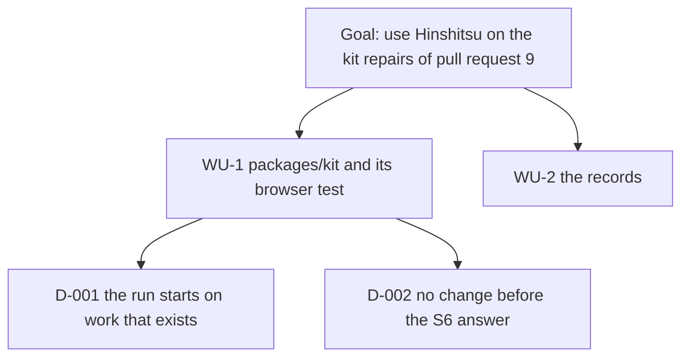

# MINDMAP — kit repairs (pull request 9)

## Hierarchy

- **Goal:** "First, please use Hinshitsu." on the kit repairs of pull request 9
  - **WU-1** the module `packages/kit` with its browser test
    - **D-001** the run starts on work that exists
    - **D-002** no change to the DELIVERABLE before the S6 answer
  - **WU-2** the records

No CRITERION exists yet; the 2 WORK UNITS hang from the goal until S4 writes the CRITERIA.

## Diagram

## Node check

| Kind | Count in `AUDIT-LOG.md` | Count in this map |
|---|---|---|
| CRITERIA | 0 | 0 |
| WORK UNITS | 2 | 2 |
| Decisions | 2 | 2 |
| FINDINGS | 0 | 0 |

<!-- from the log: start -->
Rebuilt by `scripts/hinshitsu_log.py state`. Do not edit between the marks.
- no FINDING is logged
<!-- from the log: end -->
