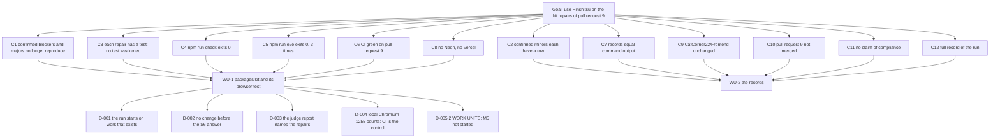

# MINDMAP — kit repairs (pull request 9)

## Hierarchy

- **Goal:** "First, please use Hinshitsu." on the kit repairs of pull request 9
  - **C1** confirmed blockers and majors no longer reproduce
    - **WU-1** the module `packages/kit` with its browser test
  - **C3** each repair has a test; no test weakened
    - **WU-1** the module `packages/kit` with its browser test
  - **C4** npm run check exits 0
    - **WU-1** the module `packages/kit` with its browser test
  - **C5** npm run e2e exits 0, 3 times
    - **WU-1** the module `packages/kit` with its browser test
  - **C6** CI green on pull request 9
    - **WU-1** the module `packages/kit` with its browser test
  - **C8** no Neon, no Vercel
    - **WU-1** the module `packages/kit` with its browser test
  - **C2** confirmed minors each have a row
    - **WU-2** the records
  - **C7** records equal command output
    - **WU-2** the records
  - **C9** CatCorner22/Frontend unchanged
    - **WU-2** the records
  - **C10** pull request 9 not merged
    - **WU-2** the records
  - **C11** no claim of compliance
    - **WU-2** the records
  - **C12** full record of the run
    - **WU-2** the records
  - Decisions: **D-001** the run starts on work that exists; **D-002** no change before the S6 answer; **D-003** the judge report names the repairs; **D-004** local Chromium 1255 counts, CI is the control; **D-005** 2 WORK UNITS, M5 not started

## Diagram

## Node check

| Kind | Count in `AUDIT-LOG.md` | Count in this map |
|---|---|---|
| CRITERIA | 12 | 12 |
| WORK UNITS | 2 | 2 |
| Decisions | 5 | 5 |
| FINDINGS | 0 | 0 |

<!-- from the log: start -->
Rebuilt by `scripts/hinshitsu_log.py state`. Do not edit between the marks.
- no FINDING is logged
<!-- from the log: end -->
